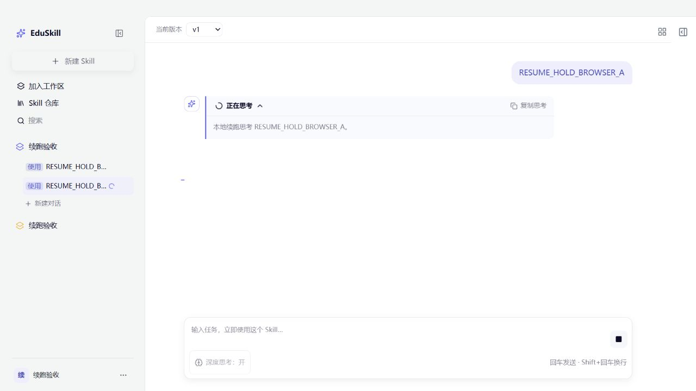
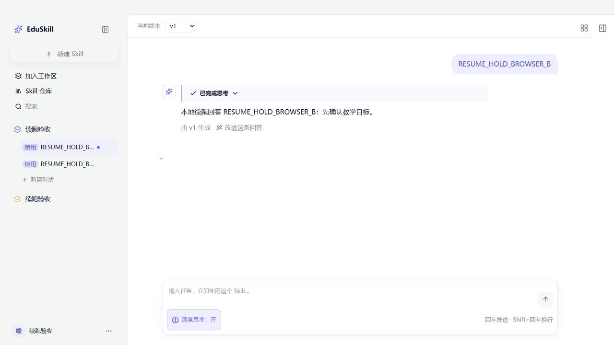

# Skill Run/Test 切换、刷新续跑验收

基线：`09fd0f48c0ceb76a76ec0085f9458f754a6f72e2`，分支 `codex/pi-core-review-fixes`。主审完成独立复核后授权本地提交；本轮不推送。

## 行为与合同

Skill Run/Test 的执行由单 Node 进程持有；切换会话、页面卸载、刷新及网络断开只解除显示订阅。只有显式停止、执行失败或超时终止执行。旧 Arena 的消息流接口保留原合同。

接口均验证身份及对话归属，路径前缀为 `/api/arena/threads/:threadId`：

| 操作 | 方法与路径 | 返回 |
| --- | --- | --- |
| 启动 | `POST /runs` | runId、revision 与完整快照 |
| 恢复 | `GET /runs` | 已保存对话历史及最近一次运行快照 |
| 查询 | `GET /runs/:runId` | 完整快照 |
| 订阅 | `GET /runs/:runId/events` | SSE `snapshot`，以 revision 替换显示 |
| 停止 | `POST /runs/:runId/stop` | 实际终态或 stopping，底层退出前保留占用 |

启动参数包含 requestId、content、model、mode=agent、thinkingEnabled；用户、threadId、requestId 共同确定请求。相同键参数不同返回冲突。前端恢复不自动重发旧提示词；历史及快照按消息 ID 合并。

单进程记录上限 128、终态 TTL 15 分钟、运行期限 180 秒、每条快照上限 1 MiB、每轮最多 32 个订阅。活动运行不被淘汰；保留期内满容量明确拒绝新请求，以保留幂等性。并发沿用配置限制，每个对话最多一轮。慢 SSE 连接等待 drain，15 秒后断开订阅，不停止执行。超过快照上限时停止执行；若超大最终结果已经保存，返回真实成功及 historyRequired，客户端自动回补数据库历史。

缓存过期或进程重启后仅加载数据库历史，不能恢复未完成的模型执行。幂等请求记录与恢复缓存共享此保留期。旧流入口与受管运行共用对话占用，活动对话删除返回 409；缺少 surface 的同 Skill 同版本旧会话继续使用 Legacy。

## 验证记录

验收入口：`educlaw-server/test-utils/resumable-local-acceptance.ts`。使用本轮自建 PostgreSQL 临时容器、实际 HTTP 路由和 Pi SDK 1.1.0、模拟模型及模拟身份网关。配置导入前拦截项目 `.env` / `.env.local` 文件读取；使用固定测试凭据，无真实模型调用。

TDD 集成基线：新增接口尚未实现时，隔离脚本各启动检查均因 HTTP 404 失败。首轮实际数据库联调发现 pg bigint 字符串消息 ID 与历史数字 ID 重复合并，修复身份规范化后回归通过。

| 最终验证 | 结果 |
| --- | --- |
| Server 全量 | 1089 通过，3 跳过；主审独立重跑一致 |
| Web 全量 | 277 单元测试、116 合同测试通过；主审独立重跑一致 |
| Server 针对性测试 | 82 通过，含背压、删除、新旧入口竞争、快照边界 |
| Linux Node 22 补充回归 | 6 文件、76 测试通过，使用既有隔离依赖镜像及本轮源代码只读挂载 |
| Shared / Server / Web 构建 | 全部通过；Vite 保留已有大 chunk 提示 |
| 修改相关源码 ESLint / diff check | 通过 |
| 实际 HTTP / PostgreSQL | 8 项通过，含真实 180 秒超时及之后重试 |

HTTP 证据见 [http-database.json](evidence/resumable-20261016/http-database.json)：断开订阅后恢复同一 run，模型执行及答案保存各一次；幂等启动、参数冲突、同会话忙、四类跨用户拒绝；精确停止和旧 runId 无副作用；Legacy 停止/故障不保存假答案；完成与恢复竞争；删除保护；Pi 故障后重试；真实期限生效后释放占用。

浏览器证据见 [browser-checks.json](evidence/resumable-20261016/browser-checks.json)。实际点击发送后 A→B→A、刷新恢复原对话：threadId=31，刷新前后 runId 均为 `5cad464a-f29f-4450-8cef-390039736a67`，模型调用 1 次。刷新后点击停止得到 cancelled，未保存答案。同会话再次发送成功，最终共 3 条消息。B 在离开期间完成：threadId=32，runId=`1afe06bb-0892-4537-87e5-700a81d7f2e1`，模型调用 1 次，数据库问题/答案各 1 条，页面答案及改进按钮各 1 个。

17:28 主审复核后，生产文件最后调整为：lite-api 复用共享请求类型；SkillDetailWorkspace 补终态回调类型；use-skill-run 将订阅/查询/停止绑定原 context.token，并只在运行状态变化时通知侧栏。新增 arena-run-sse、discover-skill-runs 已纳入针对性测试、全量测试、构建和相关 lint。最终树的测试数以 277 项 Web 单元测试为准。

## 环境清理

本轮临时 HTTP/Vite 进程和浏览器页已关闭，3219/5189 无监听；Node 22 回归容器以 --rm 退出。独立数据库名为 edu-resumable-db-20261016，数据使用 tmpfs。本轮结束时 Docker 引擎管道不可连接，停止该容器的命令无法执行，容器状态待引擎恢复后核对。未重启 Docker，未操作共享业务容器。未修改生产配置及两份用户规范。

已有 `2026-10-16-pi-core-stage1.md` 中“断开/切换取消”描述的是旧流接口。本报告及本次新接口验收取代其作为 Skill Run/Test 页面行为的验收口径。

## 验证范围

模拟模型结果证明本地执行、生命周期、恢复和持久化链路；不代表真实 Provider 推理质量或线上网关验收。本轮未重试此前已确认返回 401 的真实 Provider。Pi 正式 tools 仍为空，未改变 SDK 版本。
