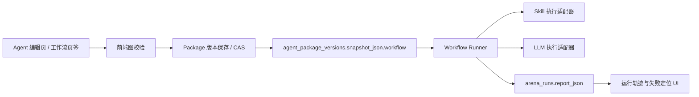

# EduSkill 工作流 MVP 方案设计

## 1. 目标与边界

工作流是 Agent 的一种执行模式：教师在 Agent 编辑页通过画布，把已有 Skill 与 LLM 步骤组织为一个有向流程，再以同一份 Agent 版本快照进行试跑。MVP 的目标是让教师稳定完成并调试“开始 → 调用 Skill → LLM → 结束”的最小流程，而不是建设通用自动化平台。

本期包含：开始、LLM、调用 Skill、条件分支、结束五类节点；画布编辑、参数配置、保存/重载、整体试跑、单节点试跑、节点级轨迹和失败重试；feature flag 灰度。

本期不包含：循环、并行分支、人工审批、定时触发器、跨 Agent 调用、外部 HTTP 工具、长期任务队列、断点续跑和生产级运行编排。服务重启时在途试跑可中断，已完成的运行报告保留。

## 2. 关键设计决策

1. **随 Agent 版本保存，而非独立工作流实体。** `WorkflowDefinition` 放入 `agent_package_versions.snapshot_json.workflow`。保存工作流与保存 Agent 配置走同一个版本 CAS，回滚 Agent 版本即可同时回滚工作流、指令和 Skill 绑定。
2. **运行时只读取快照。** 试跑先读取目标 `packageVersionId` 的 snapshot，再解析其中的工作流和 Skill 固定版本；执行期间不读取当前 Agent 配置，保证结果可复现。
3. **图是受限 DAG。** 每个工作流恰有一个开始与一个结束，所有节点必须从开始可达并能到达结束；禁止环、孤立节点和悬空边。MVP 仅允许串行执行，一条条件边被选中后继续向下。
4. **变量引用不用 `eval`。** 节点参数只允许引用 `$input`、`$node.<nodeId>.output` 和 `$node.<nodeId>.output.<field>`。条件表达式采用小型比较语法，不执行任意 JavaScript。
5. **复用现有持久化边界。** 定义存入版本快照；运行报告复用 `arena_runs.report_json`，`target_kind` 扩展为 `workflow`。不新建业务表，也不改已有对话执行链路。

## 3. 架构与数据流



### 3.1 保存链路

1. 编辑器在本地维护 `WorkflowDefinition` 草稿，并在每次图变更后执行结构校验。
2. 用户点击“保存”时，前端携带 `expectedPackageVersionId`、完整 Agent snapshot 和 `workflow`。
3. 后端通过现有 package 版本写入事务和 `PACKAGE_VERSION_CONFLICT`（409）约束创建新版本。
4. 新版本 snapshot 中的 `workflow` 与 `agentMd`、`skills` 同时落库。保存成功后，前端以新版本作为编辑基线。

### 3.2 试跑链路

1. 前端传入 `packageId`、`packageVersionId`、输入文本、`requestId` 和模式（`all` 或 `node`）。
2. Runner 校验 feature flag、包归属、请求幂等和 workflow schema，读取指定版本 snapshot。
3. Runner 从开始节点按拓扑顺序执行。每个节点完成后产生结构化 trace event；前端通过 SSE 更新节点状态。
4. 正常结束时输出结束节点结果。异常时立刻停止后续节点，把失败节点、错误码和可重试信息写入运行报告。
5. 重试只重新执行失败节点及其下游节点，保留此前成功节点的输入/输出；重试不得重新读取当前版本。

## 4. WorkflowDefinition 契约

```ts
type WorkflowNodeType = 'start' | 'llm' | 'skill' | 'condition' | 'end';

interface WorkflowDefinition {
  schemaVersion: 1;
  nodes: WorkflowNode[];
  edges: WorkflowEdge[];
}

interface WorkflowNode {
  id: string;                 // UUID，由客户端生成，版本内不可变
  type: WorkflowNodeType;
  name: string;               // 教师可编辑，仅用于展示
  position: { x: number; y: number };
  params: StartParams | LlmParams | SkillParams | ConditionParams | EndParams;
}

interface WorkflowEdge {
  id: string;
  from: string;
  to: string;
  condition?: 'true' | 'false'; // 仅 condition 节点的出边需要
}
```

节点参数如下。

| 节点 | 必填参数 | 输出 | 约束 |
| --- | --- | --- | --- |
| 开始 | 无 | `{ input: string }` | 唯一入度为 0 的节点，且无入边。 |
| 调用 Skill | `skillUid`、`skillVersionId`、`inputTemplate` | `{ text: string }` | 版本必须属于此 Agent snapshot 已启用的 Skill；保存时锁定版本。 |
| LLM | `promptTemplate`、`model?` | `{ text: string }` | `model` 为空时使用 Agent 快照模型。 |
| 条件分支 | `left`、`operator`、`right` | `{ passed: boolean }` | 仅支持 `equals`、`not_equals`、`contains`、`not_contains`、`is_empty`、`not_empty`。必须有且仅有 true/false 两条出边。 |
| 结束 | `outputTemplate` | `{ result: string }` | 唯一终点，且无出边。 |

变量模板使用 `{{ $input }}` 和 `{{ $node.<id>.output.text }}`。引用的节点必须是当前节点的上游节点；引用缺失值时返回 `WORKFLOW_VARIABLE_UNAVAILABLE`，不隐式替换为空字符串。

### 4.1 Schema 校验规则

- `schemaVersion` 必须为 `1`；节点 ID、边 ID 均唯一。
- 开始、结束节点各且仅有一个；开始无入边，结束无出边。
- 所有边的端点必须存在，且禁止自环、重复边和环。
- 非条件节点最多一条出边；条件节点必须恰有 `true`、`false` 两条出边。
- 除开始外每个节点恰有一条入边。这样 MVP 保持单路径，避免合流输入语义未定义。
- 所有节点均位于开始到结束的一条可达路径上。
- 节点总数不超过 30，单个模板不超过 8 KB，避免不受控的画布与提示词负载。
- Skill 节点不得引用未启用、已删除、版本不可用或不属于该 Agent 的 Skill。

保存接口返回所有校验错误，格式为 `{ code, nodeId?, edgeId?, message }`；前端在对应节点/连线上标红，同时保留草稿，不自动删除用户内容。

## 5. 执行模型与运行记录

### 5.1 运行上下文

```ts
interface WorkflowRunContext {
  runId: string;
  packageId: string;
  packageVersionId: string;
  definition: WorkflowDefinition;       // 从版本快照读取
  input: string;
  nodeResults: Record<string, { output: unknown; completedAt: string }>;
}

interface WorkflowNodeTrace {
  nodeId: string;
  status: 'queued' | 'running' | 'succeeded' | 'failed' | 'skipped';
  startedAt?: string;
  endedAt?: string;
  durationMs?: number;
  input?: unknown;
  output?: unknown;
  error?: { code: string; message: string; retryable: boolean };
}
```

输入、输出和错误信息只保存本次试跑所需的截断内容：单个字段最大 32 KB，整体报告最大 512 KB。超限时以明确的 `truncated: true` 标记保留摘要，避免日志无限增长。

### 5.2 节点执行语义

- **开始：** 把用户输入写入上下文并立即成功。
- **调用 Skill：** 通过 P2 提供的快照执行适配器，以固定的 `skillVersionId` 运行；输入为渲染后的 `inputTemplate`。适配器返回标准 `{ text }`，不得把 Skill 当前版本替换为最新版。
- **LLM：** 渲染 prompt 后调用选定模型。模型为空时继承 Agent 快照中的模型；运行记录实际使用的模型。
- **条件分支：** 解析变量，执行白名单操作符，只调度被选中的 true/false 边。未被选中分支的首节点及其下游标为 `skipped`。
- **结束：** 渲染输出模板并结束。结束节点不调用模型。

单节点试跑只允许开始、LLM 和 Skill 节点：执行时使用用户输入和已配置的上游节点输出样例；若缺少任一上游值，UI 要求先从开始节点进行整体试跑，不能凭空补值。条件与结束节点通过整体试跑验证即可。

### 5.3 状态、超时与重试

- 单节点默认超时 90 秒，整条工作流默认超时 180 秒；超时产生 `WORKFLOW_NODE_TIMEOUT` 或 `WORKFLOW_RUN_TIMEOUT`。
- 任一节点失败后状态为 `failed`，后续尚未执行节点为 `skipped`。不做自动重试。
- “重试”仅对 `retryable=true` 的失败节点开放，使用同一 `runId` 创建一条 `attempt + 1` 轨迹；外部输入和 package version 均固定。
- 每个 package 同时只允许一个工作流试跑；同一 `requestId` 的重复请求返回同一个运行状态，避免双击重复执行。

### 5.4 持久化与接口

复用现有 `arena_runs`：`target_kind='workflow'`，`target_ref=<packageVersionId>`，`report_json` 保存 `WorkflowRunReport`。这符合 MVP “不单独建表”的边界，且运行记录在刷新页面后仍可读取。

建议新增以下 API，全部在 `workflow` 模块中实现，不进入既有 Arena 对话路由：

| 方法 | 路径 | 用途 |
| --- | --- | --- |
| `POST` | `/packages/:packageId/workflow/validate` | 保存前校验定义和 Skill 版本归属。 |
| `PUT` | `/packages/:packageId/workflow` | 带 `expectedPackageVersionId` 保存新 package version。 |
| `POST` | `/packages/:packageId/workflow/runs` | 启动整体或单节点试跑，返回 `runId`。 |
| `GET` | `/packages/:packageId/workflow/runs/:runId` | 获取已保存的运行报告。 |
| `GET` | `/packages/:packageId/workflow/runs/:runId/events` | SSE 推送节点状态与流式 LLM 文本。 |
| `POST` | `/packages/:packageId/workflow/runs/:runId/retry` | 重试可重试的失败节点。 |

错误码统一采用 `422`：`WORKFLOW_INVALID`、`WORKFLOW_SKILL_UNAVAILABLE`、`WORKFLOW_VARIABLE_UNAVAILABLE`、`WORKFLOW_NODE_TIMEOUT`；版本冲突继续使用现有 `409 PACKAGE_VERSION_CONFLICT`。错误文案面向教师，并给出可操作的下一步。

## 6. 前端方案

### 6.1 入口与灰度

- 在 Agent 独立编辑入口新增“工作流”页签，置于“基本信息/指令/Skill”之后；只读详情页不展示编辑画布。
- `workflow_mvp` feature flag 默认关闭，前后端均校验。关闭时不渲染页签、不暴露入口，也拒绝相关 API。
- 仅产品指定内测账号可开启；打开开关后，新建 Agent 与已有 Agent 都可以编辑工作流。

### 6.2 画布与参数面板

- 左侧节点库固定 5 类节点；中间为画布，支持拖拽、连线、删除、缩放、框选与自动布局。开始/结束节点不可删除。
- 右侧参数面板按节点类型显示字段。Skill 选择器仅展示当前 Agent 已启用的 Skill 及其固定版本，删除或停用时立即提示受影响节点。
- 保存前在画布顶部显示错误摘要；节点显示名称、类型、运行状态和失败原因。颜色不作为唯一状态信息，辅以图标和文本。
- “整体试跑”放在画布工具栏；运行抽屉显示输入、按节点排序的状态/耗时和可展开的输入输出。失败节点有“重试”按钮。
- 页面离开时，如有未保存草稿，要求选择保存、放弃或继续编辑。

## 7. 模块划分与协作边界

| 模块 | 责任 | 不负责 |
| --- | --- | --- |
| `educlaw-shared/workflow` | Schema、DTO、校验错误码、运行报告类型 | 调用模型或数据库。 |
| `educlaw-server/src/services/workflow` | Schema 校验、快照加载、拓扑调度、变量解析、运行记录、SSE | 改写 Arena 现有执行路径。 |
| `workflow-skill-adapter` | 调用 P2 的 agentExecution/Skill 固定版本适配器 | 选择“当前”Skill 版本。 |
| `educlaw-server/src/routes/workflow.ts` | 权限、feature flag、请求幂等、HTTP/SSE 映射 | 内嵌编排逻辑。 |
| `educlaw-web/src/components/workflow` | 画布、参数面板、运行轨迹、草稿状态 | 自行解释或生成流程语义。 |

对 P1 的依赖是独立 Agent 编辑容器及其版本保存入口；对 P2 的依赖是可按固定 `agentExecution` 快照执行 Skill 的接口。P4 不修改 P2 既有对话路由，只调用其导出的执行适配器。

## 8. 实施顺序

1. **E4-01：定义共享 Schema 和纯函数校验器。** 先以单元测试覆盖无开始/结束、环、分支数、不可达、版本失效和变量越界。
2. **E4-02：接入 package snapshot 版本保存。** 扩展 `AgentPackageSnapshot`，确保导入旧快照时 `workflow` 缺失仍可读取为“未配置”。
3. **E4-03/E4-04：实现画布与参数面板。** 使用本地草稿和后端 validate；完成保存/重载测试后再接运行能力。
4. **E4-05：实现 runner。** 先支持开始 → Skill → LLM → 结束，再加入条件分支、SSE、运行报告与失败重试。
5. **E4-06：接入编辑页和 feature flag。** 前后端双重开关，并补访问控制回归。
6. **E4-07：按验收剧本在真实模型环境走查。** 输出运行报告 ID、对应 `packageVersionId` 和截图作为证据。

## 9. 验收剧本

| 验收项 | 场景 | 通过条件 |
| --- | --- | --- |
| 最小流程跑通 | 开始 → 已启用 Skill → LLM → 结束，输入一条教学任务。 | 四个节点依次成功，结束输出可见，报告记录全部节点耗时与固定版本。 |
| 保存重载 | 移动节点、修改 LLM prompt、选择 Skill 版本并保存后刷新。 | 节点、坐标、连线、参数和版本号完整还原。 |
| 失败定位与重试 | 使用失效 Skill 版本或让模型调用失败。 | 失败节点高亮，展示具体原因；修复可重试错误后只从失败节点继续。 |
| 版本回滚 | 保存工作流 v2，再将 Agent 回滚到无工作流或 v1。 | workflow 同步变为对应版本定义，不能看到 v2 的画布状态。 |
| 灰度关闭 | 对内测账号关闭 `workflow_mvp` 后重新登录。 | 编辑页无工作流入口，workflow API 返回受控拒绝，页面无残留文案。 |
| 旧 Agent 兼容 | 打开没有 `workflow` 字段的历史版本。 | Agent 原有编辑和对话不受影响，工作流页显示“尚未配置”。 |

## 10. 风险与缓解

| 风险 | 缓解 |
| --- | --- |
| Skill 版本被停用或删除后无法运行 | 保存和启动均校验快照中的 `skillVersionId`；提示教师切换有效版本并另存新 Agent 版本。 |
| 条件表达式被当作任意代码执行 | 只接受结构化字段和白名单操作符，服务端不使用 `eval`/`Function`。 |
| LLM 或 Skill 输出导致运行报告过大 | 字段和总报告双重上限，并明确标记截断。 |
| 并发试跑造成成本和状态混乱 | package 级单运行锁、`requestId` 幂等与超时控制。 |
| 服务重启使在途运行丢失 | MVP 明确展示“本次试跑已中断”；完成的报告已落库。后续若需要恢复执行，再引入持久队列与检查点。 |
