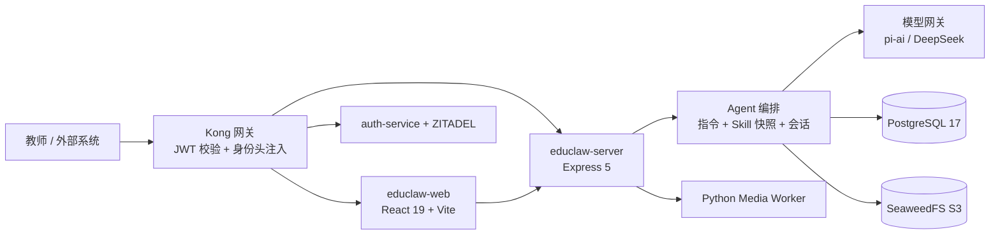
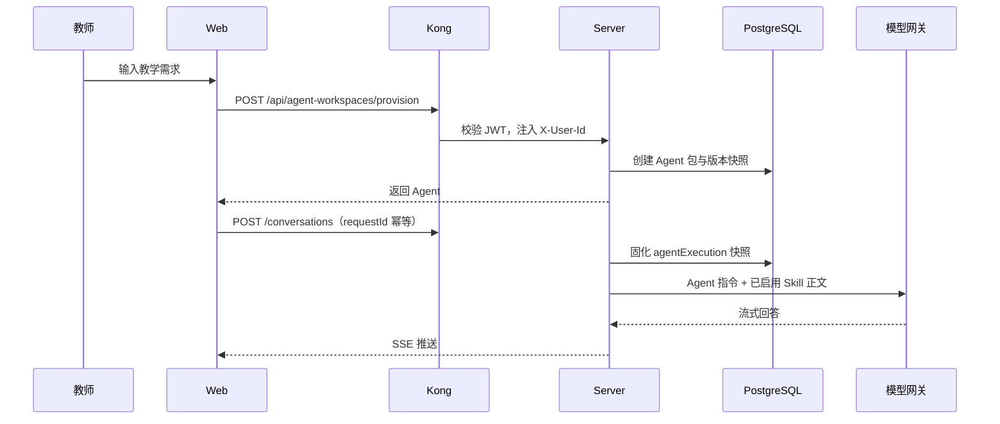

# EduSkill 技术架构（Agent + Skill）

> 技术栈、核心链路、AI Agent 工作流模式与演进方向。

## 1. 一句话架构

教师在前端用自然语言提出教学需求，Kong 完成身份校验并注入用户标识，`educlaw-server` 把需求编排成「Agent 包 + Skill 版本快照」，模型层通过统一网关生成与对话，PostgreSQL 与 S3 兼容对象存储保存版本、会话和媒体，基础设施层负责部署、身份、日志与就绪检查。

## 2. 六层技术栈

| 层级 | 本项目选型 | 主要职责 | 现状 |
| --- | --- | --- | --- |
| 前端交互层 | React 19 + Vite + TypeScript；SSE 流式 | 对话、文件上传、结果展示 | 已上线 |
| API 层 | Kong + Express 5 | JWT 校验、身份头注入、路由、授权、幂等 | 已上线 |
| Agent 层 | 自研编排（`agent-workspace-service`、`arena-service`） | Prompt 组装、Skill 快照、会话与流程状态 | 已上线（单 Agent） |
| 模型层 | `pi-ai` + 默认模型 `DeepSeek-V4.1-Flash-1017`；OpenAI 兼容网关 | 模型调用、默认模型、超时、截断与成本控制 | 已上线 |
| 数据层 | PostgreSQL 17；SeaweedFS（S3 兼容） | 业务数据、版本、会话、运行、媒体对象 | 已上线 |
| 基础设施层 | Docker Compose；ZITADEL + auth-service；结构化日志 | 部署、身份、监控、日志与安全 | 已上线（单机） |

选型说明：

- 编排层自研：Agent 配置以「包版本快照」持久化并可回放，自研实现与现有版本、幂等、权限模型直接对齐。
- 知识注入走 Skill 正文：当前教学规则规模适合直接注入上下文，链路短、结果可复现；接入知识库时使用 pgvector。
- 基础设施以 Docker Compose 为主：满足演示与单机部署；生产环境规划 Kubernetes、Prometheus、Vault。

## 3. 总体架构

## 4. 核心链路

### 4.1 生成链路

自然语言引导生成 → 产出 Skill 包（含 SKILL.md 与版本）→ `provision` 接口把 Skill 转成可对话 Agent。
下一版（工程三）：一次生成在同一个事务里创建「Agent 包 + 复制 Skill + 首版本」，Agent 与 Skill 分别进入两个仓库，失败整体回滚。

### 4.2 对话链路

### 4.3 版本与幂等

- 包即 Agent：`agent_packages` 的名称、描述、`agentMd`、模型、Skill 绑定全部来自包版本快照，没有独立的 `user_agents` 层。
- 会话固定：每个会话保存 Agent 指令、模型和每个 Skill 的版本与正文；改配置只影响新会话，历史会话不漂移。
- 幂等：`agentRequestId` 防止重复创建会话；`expectedUpdatedAt` 做版本 CAS，冲突返回 409。
- 停用：停用的 Skill 仍保留在快照中，运行只使用已启用的 Skill；全部停用返回 422。

### 4.4 失败与恢复

- 生成与保存失败整体回滚，不留下半成品包。
- SSE 断线后按已保存快照恢复；服务重启后以历史会话为准。
- 媒体任务由 Python Worker 异步处理，主链路只记录作业状态与对象地址。

## 5. AI Agent 常见工作流模式：理解与取舍

| 模式 | 核心特点 | 典型场景 | 采用情况 |
| --- | --- | --- | --- |
| 基础循环（感知—思考—行动） | 理解任务 → 推理 → 按需调用工具 → 返回 | 简单工具调用 | 已采用（单 Agent 对话） |
| ReAct | Thought → Action → Observation 交替 | 搜索、浏览器、动态决策 | 后续演进（引入工具循环后启用） |
| Plan-and-Execute | 先拆解计划，再逐步执行 | 复杂多步骤任务 | 建设中（工作流 MVP） |
| Router | 按任务类型分发到专用 Agent | 多学科、多业务入口 | 规划中（学科/任务路由） |
| 并行 Agent | 多个 Agent 同时处理独立子任务 | 批处理、多视角评审 | 后续演进 |
| Reflection | 生成后自评审、再修正 | 写作、代码、报告 | 规划中（答案自检） |
| Supervisor | 主管 Agent 调度多个专家 | 多 Agent 协作 | 后续演进 |
| Human-in-the-Loop | 关键节点人工确认 | 高风险、不可逆操作 | 已采用（保存/运行确认、危险操作二次确认） |
| RAG Agent | 先检索外部知识再生成 | 企业知识库、文档问答 | 已采用规则注入，规划接入向量检索 |
| 工具调用与异常恢复 | 重试、降级、人工介入、预算控制 | 生产级工具调用 | 已采用幂等、超时、快照恢复 |

设计原则：简单任务优先简单流程；状态和上下文显式记录；为循环设置步数、重试、Token 与时间边界；工具调用可审计；把不可控的自由推理转成可控状态机。

## 6. 最小可视化工作流（Coze 式）设计

目标：把「多步骤教学任务」变成看得见、可回放的节点图，作为 Agent 的一种执行模式。

- 节点类型（MVP）：开始、LLM、调用 Skill、条件分支、结束。
- 边：有向连线；条件节点输出 true/false 两条分支。
- 数据：`workflow_json` 存入 Agent 包版本快照，随版本回滚，不单独建表。
- 运行：按拓扑顺序执行；每个节点记录输入、输出、状态、耗时；失败定位到节点并支持重试。
- 与现有能力的映射：线性 DAG 对应 Plan-and-Execute；条件节点对应 Router；审批节点对应 Human-in-the-Loop。
- 入口：Agent 编辑页「工作流」页签，用 feature flag 灰度，不影响现有对话链路。

## 7. 非功能设计

- 安全：Kong 校验 JWT 并清理外部伪造身份头；服务端以 `X-User-Id` 做资源隔离；媒体使用签名 URL；仓库不保存密钥。
- 可观测：请求 ID + 结构化日志；`/readyz` 检查数据库与对象存储；运行层记录步数、耗时、失败节点；生产环境接入 Prometheus。
- 成本：默认模型统一配置；单次请求限制 60000 字符上下文；超时与截断可配置；模型留空走后端默认。
- 可用性：会话与版本持久化，刷新可恢复；服务重启后以历史会话为准。

## 8. 演进方向

- 生成链路升级为「Agent + Skill 原子生成」，两个仓库同源、一次事务完成。
- 工作流 MVP 进入生产：可视化编排、条件分支、节点级重试。
- 知识增强：接入 pgvector，支持知识库检索与长期记忆。
- 执行能力：引入工具调用与可恢复执行，支持服务重启后继续在途任务。
- 多 Agent：按业务需要引入 Router 与 Supervisor 模式。
