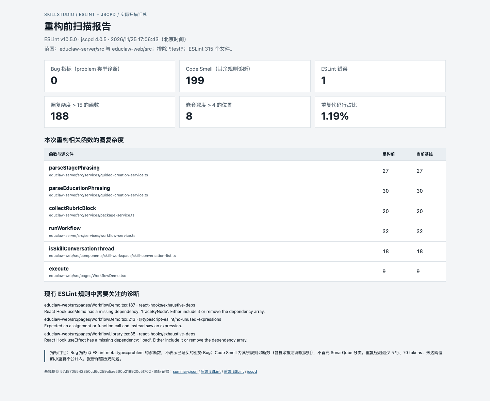
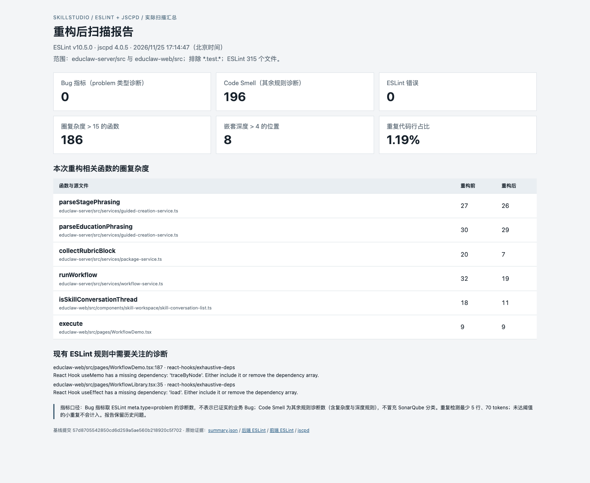

# 代码质量检查与重构报告

日期：2026-11-25。分支：`codex/agent-skill-phase1`。重构前基线：`57d8705542850cd6d259a5ae560b218920c5f702`；重构后为本次工作区代码。

## 1. 工具与扫描范围

项目已经配置前后端 ESLint。本次采用 **ESLint 10.5.0 + jscpd 4.0.5**，不需要部署 SonarQube。

- ESLint 使用各子项目现有配置，附加 `complexity: [warn, 15]`、`max-depth: [warn, 4]`。
- 范围为 `educlaw-server/src`、`educlaw-web/src`，排除 `*.test.*`。前后均为 315 个 ESLint 源文件；没有缩小扫描范围或关闭原有规则来改善指标。
- jscpd 检查同一范围内 TypeScript/TSX，最小重复块 5 行、70 tokens，排除测试、依赖、构建产物。其 sources 统计包含内嵌语言片段，不等于 ESLint 文件数。
- 本轮未扫描 Python、认证子项目、shared、openagent；结论仅适用于上述范围。

### 指标定义

老师允许使用 ESLint，而它没有 SonarQube 的 Bug / Code Smell 分类。本报告保留原始 JSON，并明确使用以下口径：

- **Bug 指标**：ESLint 规则元信息 `meta.type=problem` 的诊断数，属于潜在缺陷信号，不是已证实的业务 Bug 数。0 不代表系统不存在 Bug。
- **Code Smell 指标**：其余规则诊断数，包括复杂度、嵌套深度和可维护性问题。
- **lint 错误数**：severity=2 的诊断数，与上面的分类可能重叠，不能相加。例如本轮 `no-unused-expressions` 属于 suggestion 类型，同时以 error 级别报告。
- **圈复杂度**：ESLint `complexity` 默认算法。总体记录超过 15 的函数数，另列出本次修改的函数具体数值；新提取的函数仍参与全量扫描。
- **重复率**：jscpd `statistics.total.percentage`（重复行占比）；小于阈值的重复不会计入。

## 2. 重构前后扫描结果

| 指标 | 重构前 | 重构后 |
| --- | ---: | ---: |
| Bug 指标 | 0 | 0 |
| Code Smell 指标 | 199 | 196 |
| lint 错误 | 1 | 0 |
| 圈复杂度 > 15 的函数 | 188 | 186 |
| 嵌套深度 > 4 的位置 | 8 | 8 |
| 重复代码块 | 37 | 37 |
| 重复行数 | 822 | 822 |
| 重复率 | 1.19% | 1.19% |

减少了 1 个 lint 错误和 2 个复杂度超标函数。重复率未变化；本次选项清洗去重规模低于 jscpd 检测阈值，不声称重复率下降。

### 扫描报告截图

以下是浏览器对实际扫描 JSON 汇总页的截图，并非 SonarQube 界面。汇总页由 `scripts/render-code-quality-report.mjs` 生成，指标均可追溯到同目录原始报告。

**重构前：**



**重构后：**



- [重构前汇总与报告入口](evidence/code-quality/before/report.html)、[原始指标](evidence/code-quality/before/summary.json)
- [重构后汇总与报告入口](evidence/code-quality/after/report.html)、[原始指标](evidence/code-quality/after/summary.json)
- 各目录同时保存后端/前端 `*-eslint.json`、`jscpd-report.json`；summary 保存生产源文件 SHA-256，便于核对版本。before 的哈希由原始基线提交补录，after 的哈希在扫描时读取。

## 3. 本轮 Top 5 问题与重构对比

按阻断现有检查、业务影响和本次可安全完成的范围选择五项，属于本轮修复优先级，不宣称是全仓库复杂度最高的五个函数。为保持基本任务规模，本次没有拆分整个前端页面或重写对话系统。

### Q1：工作流试跑反馈使用副作用三元表达式

- 位置：`educlaw-web/src/pages/WorkflowDemo.tsx` 的 `execute`。
- 问题：成功/失败提示通过裸三元表达式执行，触发 `@typescript-eslint/no-unused-expressions`，导致现有 lint 不通过。
- 先补测试：`workflow-demo.test.tsx` 从真实页面输入任务并点击“整体试跑”，检查成功、业务失败、缺失错误信息的回退提示、网络异常后解除 busy 状态；只模拟画布和 API，不用源码字符串断言。
- 重构前：`report.status === 'succeeded' ? toast.success(...) : toast.error(...)`。
- 重构后：明确使用 `if / else`；模型请求、报告更新、错误提示与 `finally` 清理保持原有行为。
- 结果：该 lint 错误 1 → 0；函数复杂度 9 → 9。本项改善可读性和规则符合性，不虚报复杂度下降。

### Q2：工作流运行函数混合节点执行与运行生命周期

- 位置：`educlaw-server/src/services/workflow-service.ts` 的 `runWorkflow`。
- 问题：节点类型判断、循环模型调用、Skill 提示组装与报告持久化集中在一个函数内，复杂度 32。
- 先补测试：`workflow-service.test.ts` 验证开始/结束、LLM、固定版本 Skill、循环上下文传递、真假条件分支、模型异常脱敏、幂等重放，共 8 个用例。调用公开服务入口，数据库和模型使用 mock。
- 重构前：`runWorkflow` 内嵌一长段 `if / else` 执行全部节点。
- 重构后：提取 `executeWorkflowNode` 和 `executeLoopNode`；`runWorkflow` 保留鉴权后的版本读取、幂等查询、流转、trace 状态和最终入库。
- 结果：`runWorkflow` 复杂度 **32 → 19**；仍高于 15，后续可继续拆分报告状态处理，本轮不扩展范围。

### Q3：Rubric 内容截取的边界判断嵌套过多

- 位置：`educlaw-server/src/services/package-service.ts` 的 `collectRubricBlock`。
- 问题：遍历与 Markdown/编号标题的边界判断交织，复杂度 20。
- 先补测试：`package-service.rubric-cleanup.test.ts` 增加 3 个参数化用例，验证 Markdown/编号标题下保留 h4 细则、保留维度内容、停止收集后续章节。
- 重构前：循环中多层 `if` 判断标题级别、正文标识和编号章节。
- 重构后：提取 `isRubricBlockBoundary`；循环只负责收集和计数，保留“编号标题下 h4+ 仍属于正文”等原有规则。
- 结果：`collectRubricBlock` 复杂度 **20 → 7**。

### Q4：Skill 会话归属条件难以维护

- 位置：`educlaw-web/src/components/skill-workspace/skill-conversation-list.ts` 的 `isSkillConversationThread`。
- 问题：左右侧是否存在、是否属于当前 Skill、版本是否一致通过较长布尔表达式组合，复杂度 18。
- 先补测试：在既有单边历史用例基础上，增加拒绝 Agent 执行、缺失配置、混合版本，以及对比会话只需一侧命中的边界测试。
- 重构前：`!!(left || right) && (!left || ...) && (!right || ...) && (!left || !right || ...)`。
- 重构后：先取得有效绑定，再验证非空且每个绑定属于同一 Skill 和版本；保留 arena 分支的单侧命中逻辑。
- 结果：`isSkillConversationThread` 复杂度 **18 → 11**。

### Q5：三版引导问答重复清洗模型选项

- 位置：`educlaw-server/src/services/guided-creation-service.ts` 的 `parsePhrasing`、`parseStagePhrasing`、`parseEducationPhrasing`。
- 问题：三处重复数组判断、字符串过滤、去空格、去空项和最多四项的逻辑，后续修改容易不一致。
- 先补测试：增加 V2/V3 公共会话入口用例，输入空项、非字符串、首尾空格和超过四项的模型选项，检查清洗后完全一致。既有用例继续覆盖回退提问和默认选项。
- 重构前：三份独立清洗实现。
- 重构后：统一调用 `normalizeSuggestedOptions(value: unknown)`，各版本仍保留自己的问题校验和默认选项。
- 结果：清洗实现 **3 份 → 1 份**；两个相关函数复杂度分别 **27 → 26**、**30 → 29**。此重复低于 jscpd 阈值，全局重复率仍为 1.19%。

完整生产代码前后差异：[refactoring.patch](evidence/code-quality/refactoring.patch)。

## 4. 测试顺序和验证证据

先新增测试并在原始生产代码上执行，再修改生产代码。初次运行遇到拉取新代码后 shared 构建过期和依赖未补齐，完成安装及 shared 构建后保存正式的通过日志。

| 验证 | 结果 | 证据 |
| --- | --- | --- |
| 重构前，3 个后端相关测试文件 | 53 / 53 通过 | [server-tests.txt](evidence/code-quality/before/server-tests.txt) |
| 重构前，2 个前端相关测试文件 | 10 / 10 通过 | [web-tests.txt](evidence/code-quality/before/web-tests.txt) |
| 重构后，7 个后端相关测试文件 | 70 / 70 通过 | [server-tests.txt](evidence/code-quality/after/server-tests.txt) |
| 重构后，2 个前端相关测试文件 | 10 / 10 通过 | [web-tests.txt](evidence/code-quality/after/web-tests.txt) |
| `pnpm lint` | 0 错误，2 个已有 Hooks 警告 | [lint.txt](evidence/code-quality/after/lint.txt) |
| `pnpm check:types` | 相对项目已存基线无新增错误；仍有 249 条历史诊断 | [typecheck.txt](evidence/code-quality/after/typecheck.txt) |
| `pnpm build` | shared、openagent、server、web 构建通过；前端有 chunk 大小提示 | [build.txt](evidence/code-quality/after/build.txt) |

本次新增 17 个回归用例。扩大验证时，发现 `package-service.rubric-actions.test.ts`、`package-service.repair.test.ts` 的 SQL mock 尚未适配已有的 `model` 列。用原始基线 `package-service.ts` 复现相同失败后，更新 mock 的 SQL 和参数位置，未修改数据库业务逻辑。[原始基线复现日志](evidence/code-quality/before/existing-rubric-test-failures.txt)。

这里的测试是本次相关模块测试；没有运行全部仓库测试、真实数据库集成测试或真实模型调用，不把局部验证描述为全项目测试通过。

## 5. 复现方式

依赖安装后，在仓库根目录运行：

```sh
pnpm install --frozen-lockfile
pnpm build:shared
pnpm quality:test
pnpm lint
pnpm check:types
pnpm build
pnpm quality:scan after
pnpm quality:report
```

首次建立新基线、尚未重构时使用 `pnpm quality:scan before`。脚本会拒绝覆盖已有 before 基线，以防把重构后的数据误写成重构前。`quality:report` 需要 before/after 两份 summary。

截图是已提交目录中的 PNG；重新扫描或更改汇总页之后，需重新用浏览器打开对应 `report.html` 截图。原始报告、截图和文档应保持同一版本。

## 6. 遗留项

当前仍有 186 个复杂度超标函数、8 处深层嵌套、2 个 Hooks 依赖警告及历史类型诊断。本次完成基本任务所选的 5 项，不通过关规则、隐藏文件或降低阈值消除历史问题。评审记录见 [code_review.md](code_review.md)。
