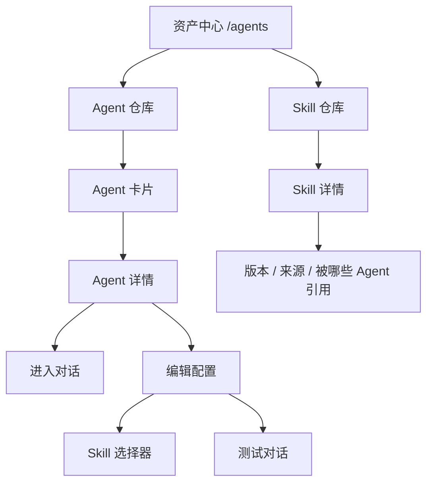

# EduSkill 原型设计

> 依据课程原型设计三层模型：**用户任务与场景 → 界面设计 → 视觉设计 → 用户体验**，并附可直接用于评审的检查清单。

## 1. 用户任务与场景

**用户**：一线教师、教研员，不是开发者。

**核心任务**：把「我的教学方法」变成可复用的教学助手，并在备课时直接用自然语言对话。

| 场景 | 用户目标 | 设计要点 |
| --- | --- | --- |
| 从零生成 | 描述教学需求，得到可用的教学助手 | 自然对话追问，不让用户写 Prompt；生成即得 Agent + Skill |
| 资产复用 | 管理自己的 Agent 与 Skill，查看版本和关联 | 统一资产中心，两个页签；详情页只读，编辑独立入口 |
| 日常使用 | 以 Agent + Skill 对话完成备课任务 | 任何入口都进入同一种对话形态；回答可追溯、可控制 |

**约束**：老师不熟悉 Prompt 和工作流；主路径要在 3 步内可用；移动端侧栏可折叠。

## 2. 界面设计（结构 · 组件 · 流程）

### 2.1 信息架构

信息分区原则：

- 上层是「资产」：名称、描述、模型、当前版本、最近使用。
- 中层是「关系」：Agent 关联了哪些 Skill、启用状态、固定版本。
- 下层是「动作」：进入对话、编辑配置、版本历史。

### 2.2 布局

- 资产中心：顶部搜索与页签，主区为卡片栅格；Agent 卡片显示模型、Skill 数、版本、最近对话。
- Agent 详情：单列信息卡（概览 → 关联 Skill → 版本），与 Skill 详情同构；默认只读。
- 编辑配置：独立页面或抽屉，左侧基本信息与指令，右侧 Skill 选择器；「组装 Skill」只出现在这里。
- 对话工作区：左侧会话列表，右侧主对话；顶部固定 Agent 身份与 Skill 徽章。

### 2.3 组件

| 组件 | 作用 | 关键行为 |
| --- | --- | --- |
| 输入框 | 发起对话 | Enter 发送，Shift+Enter 换行；发送中禁用 |
| 消息气泡 | 区分用户与 Agent | 支持 Markdown、引用折叠、错误重试 |
| 状态徽章 | 表达 Skill 状态 | 启用 / 停用 / 版本不可用 |
| 折叠卡 | 收纳 Skill 列表与引用 | 默认收起，可展开核验来源 |
| 版本选择器 | 固定 Skill 版本 | 只显示可用版本，切换后提示影响新会话 |
| 空态卡 | 降低上手成本 | 给出示例问题，而不是空白输入框 |
| 错误条 | 恢复失败操作 | 说明原因 + 重试按钮（自动创建失败可重试） |
| 提示条 | 告知保存/运行结果 | 成功、拦截、警告三种语气 |

### 2.4 主流程

- 主按钮：`进入 Agent 对话`；次按钮：`查看 Skill`。
- 生成完成后自动进入对话，但必须等对话历史加载完成，避免重复建会话。
- 保存并使用 = 保存配置 + 创建会话，一步完成。

## 3. 视觉设计（色彩 · 字体 · 间距）

| 项目 | 规范 |
| --- | --- |
| 主色 | 品牌绿，仅用于主按钮、选中态、关键链接 |
| 语义色 | 成功 / 警告 / 错误三种，只表达状态，不做装饰 |
| 中性色 | 背景、表面、边框、主文字、次文字、禁用共 6 档 |
| 字体 | 标题 20/18（600），正文 14（400），辅助 12（400），行高 1.5 |
| 间距 | 4 的基础栅格：4 / 8 / 12 / 16 / 24 / 32 |
| 圆角 | 卡片 12，按钮与输入框 8 |
| 图标 | 16/20 线性图标，少而一致，只用于动作与状态 |
| 层次 | 对话区高对比、低噪声；卡片弱阴影，不用渐变和纹理 |

一致性原则：同一个「运行」「保存」「重试」动作在 Agent 仓库、Skill 仓库和对话页使用同一套按钮与文案。

## 4. 用户体验（反馈 · 容错 · 信任）

### 4.1 任务流

- 生成 → 确认 Agent → 对话，三步完成；不要求用户先理解 Skill 与版本。
- 从 Skill 页进入时自动转成 Agent 并直接开聊，减少一次跳转。

### 4.2 状态设计

| 状态 | 呈现 | 用户可做的下一步 |
| --- | --- | --- |
| 空 | 示例问题 + 创建入口 | 使用示例或新建 |
| 加载 | 骨架屏 / 进度 / 「思考中」 | 等待，或取消 |
| 成功 | 轻提示 + 自动进入结果 | 继续对话、查看版本 |
| 拦截 | 说明原因（如未启用 Skill） | 去启用或换 Agent |
| 出错 | 原因 + 重试 + 保留已输入内容 | 重试或返回 |

### 4.3 容错与信任

- 自动创建 Agent 失败可重试；保存冲突提示刷新后重试；版本失效提示重新选择。
- 删除、覆盖等危险操作二次确认；停用 Skill 可随时恢复。
- 回答流式输出；引用可展开核验；明确说明 Agent 能做什么、不能做什么。
- 历史会话固定原版本，用户可控制「改配置只影响新会话」。

## 5. 原型评审清单

### 通用可用性（Nielsen 启发式）

| 检查项 | 结论 | 设计/证据 |
| --- | --- | --- |
| 状态可见 | 通过 | 空/加载/成功/拦截/出错五态齐全 |
| 贴近真实 | 通过 | 文案用「教学助手」「备课」等教师语言，不暴露 Skill 版本术语 |
| 用户可控 | 通过 | 可停用、可切换版本、可新建会话、失败可重试 |
| 一致性 | 通过 | 三个入口共用同一套卡片、按钮与对话页 |
| 防错 | 通过 | 必填校验、危险操作二次确认、未启用 Skill 禁止运行 |
| 识别优于回忆 | 通过 | 示例问题、可选 Agent 列表，不让用户记 ID |
| 高效 | 通过 | Enter 发送、默认模型、保存并运行一步完成 |
| 极简 | 部分 | 详情页已剥离拼装；编辑态信息仍较多，下一步做分组折叠 |

### 智能体专项

| 检查项 | 结论 | 设计/证据 |
| --- | --- | --- |
| 边界声明 | 通过 | Agent 详情说明适用场景与不适用场景 |
| 来源可追溯 | 部分 | 会话记录 Skill UID 与版本；回答引用展开待补 |
| 风险分级 | 原型 | 高风险操作（删除、覆盖）二次确认；教学场景风险提示待细化 |
| 拦截可理解 | 通过 | 422「请先启用至少一个 Skill」等可执行文案 |
| 等待可感知 | 通过 | 流式输出与「思考中」状态 |
| 隐私透明 | 部分 | 说明数据仅用于本次生成；脱敏能力待补 |
| 无障碍 | 部分 | 键盘可达、对比度达标；颜色不作为唯一信息载体 |
| 响应式 | 通过 | 移动端侧栏可折叠 |
| 错误可恢复 | 通过 | 错误信息 = 原因 + 下一步 + 重试 |

