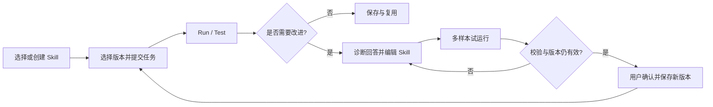

# 工作台低保真原型

本文用文本线框记录主要工作流，供产品、研发和评审讨论。它不是可交互网页，也不承诺现有 UI 像素布局完全一致。框架依据当前 Skill-first 工作台、版本、Arena、回答优化和媒体能力整理；实现对应关系列在每个草图下。

## 1. Skill 工作区

```text
┌────────────────────────────── SkillStudio ──────────────────────────────┐
│ 搜索 / 新建 Skill / 导入                         用户与设置              │
├──────────────────┬─────────────────────────┬──────────────────────────┤
│ Skill 仓库       │ 当前任务                 │ 上下文 / 版本            │
│                  │                          │                          │
│ ▸ 我的 Skill     │ 选中的 Skill 与版本      │ Skill 说明               │
│   最近使用       │                          │ 当前版本 / 历史版本      │
│   草稿           │ 用户输入                 │ 运行参数 / 来源          │
│                  │                          │                          │
│ + 创建 Skill     │ [发送] [Run] [Test]      │ [查看] [比较] [回退]     │
└──────────────────┴─────────────────────────┴──────────────────────────┘
```

交互要点：选择 Skill 和明确版本后再运行；Run 面向真实任务，Test 面向固定样本验证；消息记录实际使用的版本；刷新页面时可恢复支持恢复的异步 Run。窄屏下侧栏和上下文面板应折叠为可访问入口。

代码对应：`educlaw-web/src/pages/SkillFirstWorkspace.tsx`、`src/components/arena/`、`src/components/deep-study/`。

## 2. 回答优化与版本确认

```text
┌────────────────────── 回答优化 ────────────────────────────────────────┐
│ 原问题 / 原回答 / Skill 版本来源                                        │
├─────────────────────┬───────────────────────┬─────────────────────────┤
│ 诊断与目标           │ Skill 修改草稿         │ 验证与保存               │
│                      │                        │                         │
│ 发现的问题           │ 原文 ↔ 建议 Diff       │ 测试样本结果              │
│ 改进目标             │ 可继续对话调整          │ 门禁状态 / 失败原因        │
│                      │                        │                         │
│                      │                        │ [保存新版本] [取消]       │
└─────────────────────┴───────────────────────┴─────────────────────────┘
```

交互要点：显示来源回答及 Skill 版本，避免丢失优化上下文；先展示 Diff，再运行多个样本；测试结果需说明事实依据和限制；只有通过服务端校验、处理版本冲突并由用户确认后，才创建新版本。评分或模型建议不能替代教育人员判断。

代码对应：`educlaw-web/src/api/answer-skill-optimizations.ts`、`src/components/deep-study/OptimizePanel.tsx`；服务端流程位于 `educlaw-server/src/services/answer-skill-optimization-service.ts` 等服务文件。

## 3. 媒体任务

```text
┌────────────────────── 媒体工作流 ──────────────────────────────────────┐
│ 选择文件 / 上传到对象存储                                                │
├────────────────────────────────────────────────────────────────────────┤
│ 任务状态：等待 → 处理中 → 可查看结果 / 失败可重试                         │
│ 进度：阶段与最近更新时间                                                 │
│ 结果：质量检查 / 转录或蒸馏产物 / 错误摘要                                │
│ [查看产物] [重试] [取消]                                                 │
└────────────────────────────────────────────────────────────────────────┘
```

交互要点：向用户展示来自服务端的任务状态；长任务允许离开页面后再查看；失败时保留可诊断信息，不能显示虚假成功。对象存储 URL、内部 Worker token 和模型密钥不能显示在页面或日志中。

## 4. 主路径状态图



## 5. 评审关注点

- 当前版本、历史版本和回答来源在界面上可区分。
- 保存、回退、删除等会改变状态的操作有明确的确认与结果反馈。
- 流式回答、异步 Run 和媒体任务提供等待、失败、取消及恢复状态。
- 小屏布局、键盘操作、焦点可见性与减少动态效果需纳入实际 UI 验收；本草图不是可访问性验收证据。
